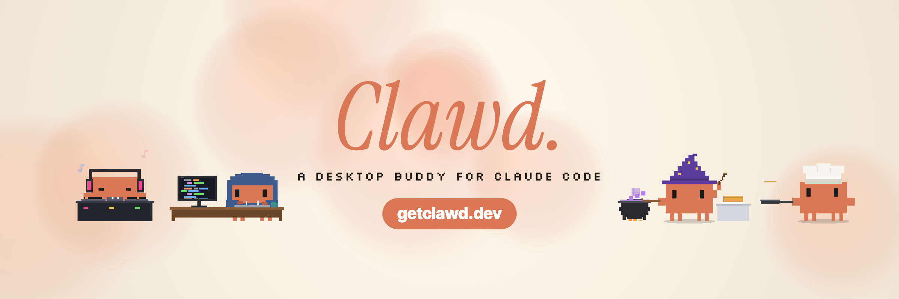
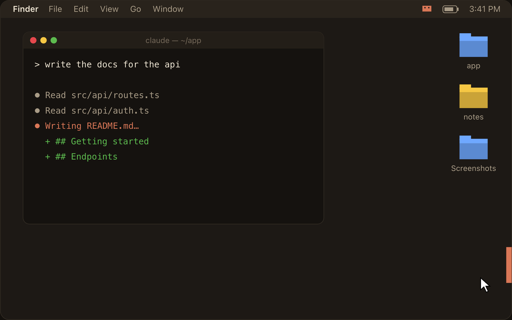
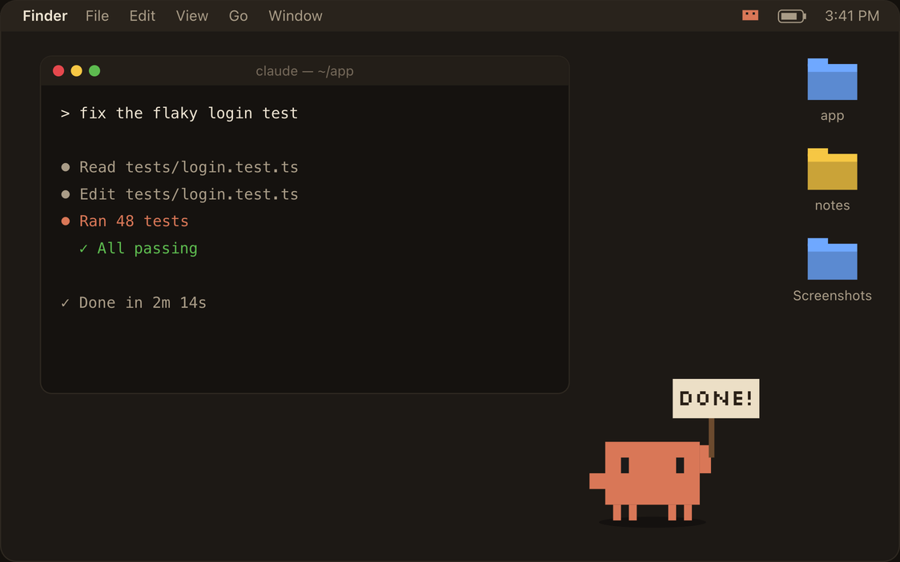
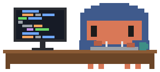
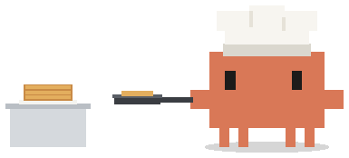
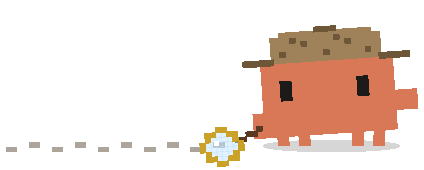
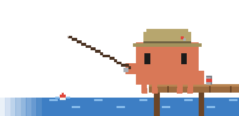
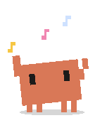
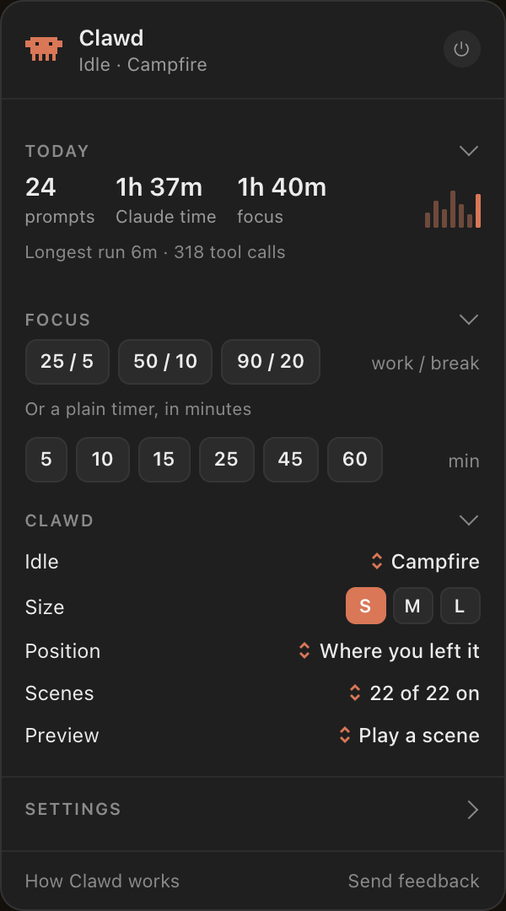

  

  
  
  
  
  

  <b>A tiny pixel friend who keeps you company while Claude Code works.</b> 
  He acts out little scenes, tells you what Claude is up to, and celebrates when it's done.

  <a href="https://github.com/sxndyx/clawd/releases/latest/download/Clawd.dmg"><b>Download for Mac</b></a>
  &nbsp;·&nbsp;
  <a href="https://getclawd.dev">Website</a>
  &nbsp;·&nbsp;
  <a href="CHANGELOG.md">Changelog</a>
  &nbsp;·&nbsp;
  <a href="https://github.com/sxndyx/clawd/issues/new/choose">Report a bug</a>

 

## Why Clawd

Claude Code is brilliant, but a lot of the time you're just watching it think. Clawd turns that wait into something nice to look at. He lives on your desktop, picks up a scene when you send a prompt, and keeps you posted in a little speech bubble. When Claude finishes, he throws confetti, so you know without having to check.

  
  

## What he does

- **22 scenes while Claude works.** Coding, cooking, fishing, a rocket ride, a game of pong and more. Some follow the work: reading files sends him to the library, searching turns him into a detective.
- **Says what Claude is doing.** "Reading auth.ts", "Running the tests". Click the bubble to jump straight back to the terminal tab Claude is in.
- **A progress line** creeps along the bottom of your screen, paced by how long your prompts usually take.
- **Celebrates when it's done,** and waves you back if you've wandered off to another app.
- **Focus sessions and timers.** 25/5, 50/10 or your own rhythm, with a coffee break between rounds.
- **Music.** When Spotify or Apple Music plays, he DJs, dances or holds up the album, with play and skip buttons over his head.
- **Stays out of the way.** He dives off the edge of the screen for full-screen videos, tucks into the side when you want him gone, and you can drag or throw him anywhere.
- **Little things.** Late-night "bedtime?" nudges, a low-battery look, break reminders, and 21 rare finds to discover along the way.

## Scenes

<table>
  <tr>
    <td align="center"> Coder</td>
    <td align="center"> DJ</td>
    <td align="center"> Chef</td>
    <td align="center"> Wizard</td>
  </tr>
  <tr>
    <td align="center"> Detective</td>
    <td align="center"> Fishing</td>
    <td align="center"> Library</td>
    <td align="center"> Music</td>
  </tr>
</table>

Eight of the 22. See them all, moving, at <a href="https://getclawd.dev/#scenes">getclawd.dev</a>.

## The menu

<table>
  <tr>
    <td width="42%" valign="top"></td>
    <td valign="top">

Click Clawd to open his menu.

**Today.** Prompts, Claude time and focus time, with the last seven days.

**Focus.** Focus sessions or a plain timer, with your pick of scenes.

**Clawd.** His idle animation, size, spot on screen and which scenes play. Hover over him for back, shuffle and next buttons under his feet.

**Settings.** Confetti, music, updates and the Claude Code connection.

Everything else lives under **Advanced Settings** in the Clawd icon in your menu bar: break nudges, hiding during videos, opening at login, following chats in the Claude app and more.

</td>
  </tr>
</table>

## Install

1. **[Download Clawd.dmg](https://github.com/sxndyx/clawd/releases/latest/download/Clawd.dmg)** and drag Clawd into Applications.
2. **Open it.** This is a free test build that isn't signed with an Apple Developer ID yet, so macOS asks once. Click **Done**, then go to **System Settings → Privacy & Security** and click **Open Anyway**.
3. **Connect.** Clawd offers to connect to Claude Code. That adds a few hooks to `~/.claude/settings.json` (your original is backed up next to it).
4. **Start a new Claude Code session** and send a prompt.

Requires macOS 14 Sonoma or later, on Apple Silicon or Intel. Clawd updates himself from then on, never in the middle of a prompt.

## Works with

| | |
|---|---|
| **Claude Code in any terminal** | Terminal, iTerm2, Ghostty, Warp, VS Code and more. In Terminal and iTerm2, clicking his bubble brings up the exact tab. |
| **Claude Code in the Claude app** | The Code tab works through the same hooks. |
| **Chats in the Claude app** | Optional. Turn on Claude app chats in Advanced Settings (needs Accessibility access). |

## Privacy

Clawd runs on your Mac and has no account, analytics or tracking.

- **Claude Code.** The hooks tell Clawd when a prompt starts and stops and which tool is running, so he can say "Editing auth.ts". Your prompts and code never leave your Mac.
- **The network.** Clawd checks [getclawd.dev](https://getclawd.dev/update.json) for updates and downloads them from GitHub Releases. When music is playing he looks up the album art and lyrics for the current song. Rare finds keep an anonymous count of how many people have found each one. Feedback is only sent when you send it.
- **Permissions.** None are needed to get started. Accessibility is only asked for if you turn on Claude app chats. Clawd reads window positions (to dodge full-screen videos and hop onto screenshot thumbnails), never what's in them.

Disconnect, in the menu bar under Advanced Settings, removes the hooks again. More in [SECURITY.md](SECURITY.md).

## FAQ

<b>Why does macOS say it can't verify Clawd?</b>

 
Clawd isn't notarised with an Apple Developer ID yet. Open it once from <b>System Settings → Privacy & Security → Open Anyway</b> and macOS remembers. Updates install without asking again.

<b>Clawd doesn't react to my prompts.</b>

 
Claude Code only reads hooks when a session starts, so start a new session after connecting. If he still doesn't react, check that Claude Code shows as <b>Connected</b> under Settings in his menu, and click Reconnect if it says so.

<b>Where did he go?</b>

 
He might be tucked into the side of the screen (click the little tab on the edge), hiding during a full-screen video, or set to only appear while Claude works (<b>Stay on Desktop</b> in Advanced Settings).

<b>How do I uninstall him?</b>

 
Click <b>Disconnect</b> (menu bar icon → Advanced Settings → Claude Code), quit Clawd, and drag him from Applications to the Bin.

## Feedback

Clawd is made by one person and gets better mostly from what people send.

- **Found a bug?** [Open a bug report](https://github.com/sxndyx/clawd/issues/new?template=bug_report.yml).
- **Got an idea for a scene?** [Suggest one](https://github.com/sxndyx/clawd/issues/new?template=scene_idea.yml).
- **Anything else?** Use **Send feedback** in Clawd's menu or on [the website](https://getclawd.dev).

 

  Clawd is an independent project and isn't affiliated with or endorsed by Anthropic. Claude is a trademark of Anthropic. 
  <a href="https://getclawd.dev">getclawd.dev</a>

